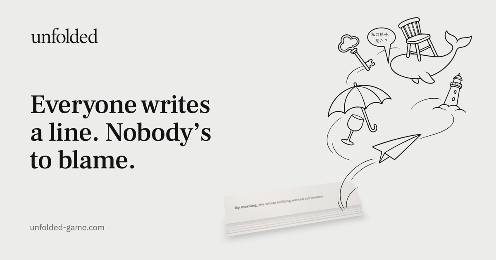

# Unfolded — landing page

The marketing site for **Unfolded**, a party game where friends write one story together on their phones.
Each player sees only the last few words before their turn, folds the page, and passes it on. At the end,
someone reads the whole thing out loud.

- **Live site:** https://unfolded-game.com
- **Design system:** https://unfolded-game.com/design-system
- **The game:** https://play.unfolded-game.com

Designed and built by [Natalie Tarnovsky](https://hire-natalie.today). I'm a product designer, and I made this
page to show a design carried all the way into production code.



## Lighthouse

100 / 100 / 100 / 100 (Performance, Accessibility, Best Practices, SEO) on both mobile and desktop.
Measured on the live site on 2026-11-07.

## Stack

- **[Astro](https://astro.build) + TypeScript.** Static HTML, with JavaScript only where something moves.
- **Plain CSS with design tokens** (CSS custom properties). No Tailwind, no CSS framework.
- **GSAP + ScrollTrigger** for motion. **WebGL** for the folding paper sheet, ported from the game itself.
- **Content collections.** Every word on the page lives in `src/content/*.json` and is checked against a schema
  at build time, so the copy can move to a CMS later without touching components.
- **Vercel** for hosting.

## Design system

`src/styles/tokens.css` holds every color, type size, space, radius, duration and easing. The base values use the
game's own names and numbers, so the site and the app share one visual language. Components use only the semantic
layer on top (`--color-text`, `--color-surface`…), never raw values.

Components live in `src/components/ui/`: Button, Section, Container, Heading, Card, Badge, Link, Mark, Accordion.
The [/design-system](https://unfolded-game.com/design-system) page renders the tokens straight from `tokens.css`
(with WCAG contrast ratios for the color pairs) and shows every component, in English and in Hebrew (right-to-left),
because the game is used in both languages.

## Accessibility and motion

- Semantic HTML, a skip link, visible focus, keyboard-operable accordion (following the WAI-ARIA pattern).
- **Reduced motion is respected everywhere.** With "Reduce motion" on, durations collapse to almost zero and the
  scroll animations are replaced by still pictures.
- Content never depends on JavaScript: without it, everything is simply visible (the FAQ ships open).
- The folding sheet loads only on desktop, after the first scroll, and keeps showing the flat paper image if WebGL is unavailable.

## Run it locally

Needs Node 22 or later.

```sh
npm install
npm run dev       # http://localhost:4321
npm run build     # production build into dist/
npm run preview   # serve the production build
npm run check     # type-check
```

## Deploy

Vercel builds and publishes every push to `main` automatically. There is no manual deploy step.

- `unfolded-game.com` points to Vercel (DNS at Porkbun), and `www` redirects to the root.
- `play.unfolded-game.com` is the game, hosted separately on Render.
- `vercel.json` sends the game's old links on the root domain (`/?room=…`, `/en`, `/privacy.html`) to `play.`.

## Social preview image

`public/og.png` (1200×630) is rendered from `src/components/OgCard.astro`. Regenerate it whenever the hero headline
or illustration changes. The steps are in that file's header comment.

## Project map

```text
src/
  content/       every word on the page (JSON + schemas in content.config.ts)
  styles/        tokens.css (design tokens), base.css (reset, type, focus)
  components/ui/ design-system components
  components/sections/  page sections: Hero, PaperStory, HowItWorks, Faq, FinalCta…
  scripts/       motion helpers (GSAP), the WebGL paper fold
  pages/         index.astro, design-system.astro
```
